<p align="center">
  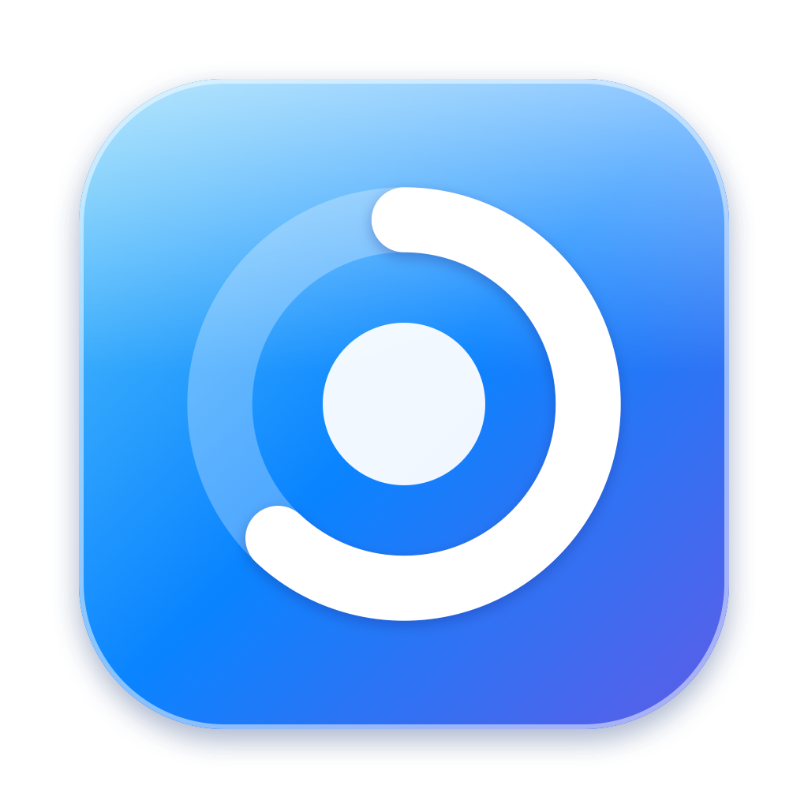
</p>

<h1 align="center">Sector</h1>

<p align="center">
  <b>See what's eating your Mac's disk — and get it back, safely.</b><br>
  A fast, beautiful disk analyzer and cleaner, built natively for macOS.
</p>

<p align="center">
  
  
  
  
  <br>
  
  
  
  
  
  
  <a href="LICENSE"></a>
</p>

<p align="center">
  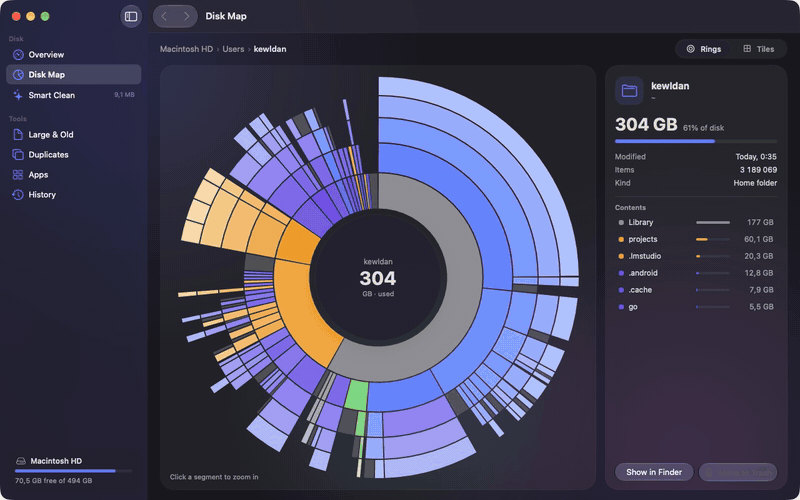
</p>

## ✨ Highlights

- ⚡️ **Fast.** A parallel scanner built on `getattrlistbulk(2)` walks 2 million files in about 6.5 seconds — roughly 5× faster than `du`, with byte-identical totals.
- 🪐 **Disk Map.** Interactive rings and tiles drawn from precomputed geometry. Click a segment to fly into a folder; hover anything to see what it is.
- ✨ **Smart Clean.** Xcode caches, stale `node_modules`, unused Docker images, old simulators, app caches, logs and old downloads — found in one pass and cleaned in one click.
- 👯 **Duplicates.** Size → partial hash → full SHA-256, in parallel. APFS clones are recognized, so the "waste" number is what deleting really frees.
- 📦 **Apps.** Every app with its hidden data in `~/Library`: remove an app completely, or just reset its data.
- ↩️ **Safe by default.** Everything goes to the Trash, and History can put files back where they were for 30 days.
- 🚀 **Instant launch.** The last scan is cached on disk (a 2-million-node tree loads in about 10 ms), then refreshed quietly in the background.
- 🎛️ **Lives in your menu bar.** Free space at a glance, a one-click clean, low-space notifications, and two desktop widgets.
- 🎨 **Made for macOS 26.** Native Liquid Glass chrome, spring animations everywhere, Reduce Motion respected, light and dark.

> [!TIP]
> Give Sector **Full Disk Access** (System Settings → Privacy & Security → Full Disk Access). Without it macOS hides Mail, Safari, other apps' containers and the Trash, and Sector shows how much it couldn't see.

## 📸 Screenshots

| Overview | Disk Map |
| :---: | :---: |
| 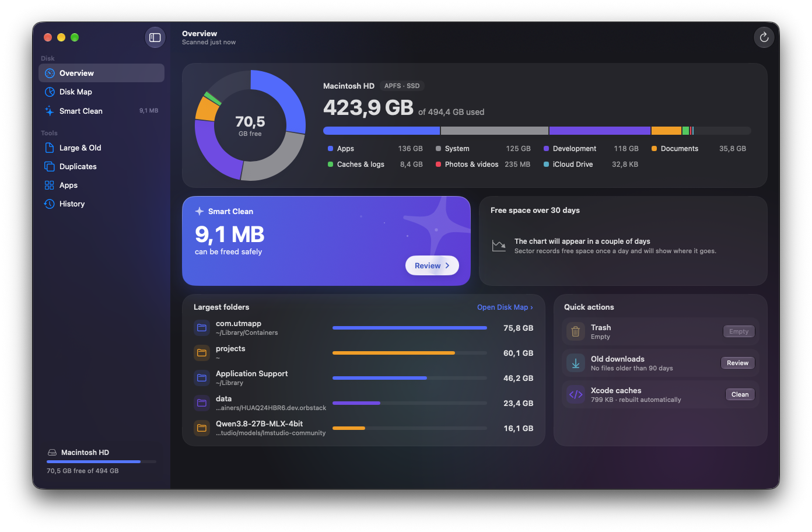 | 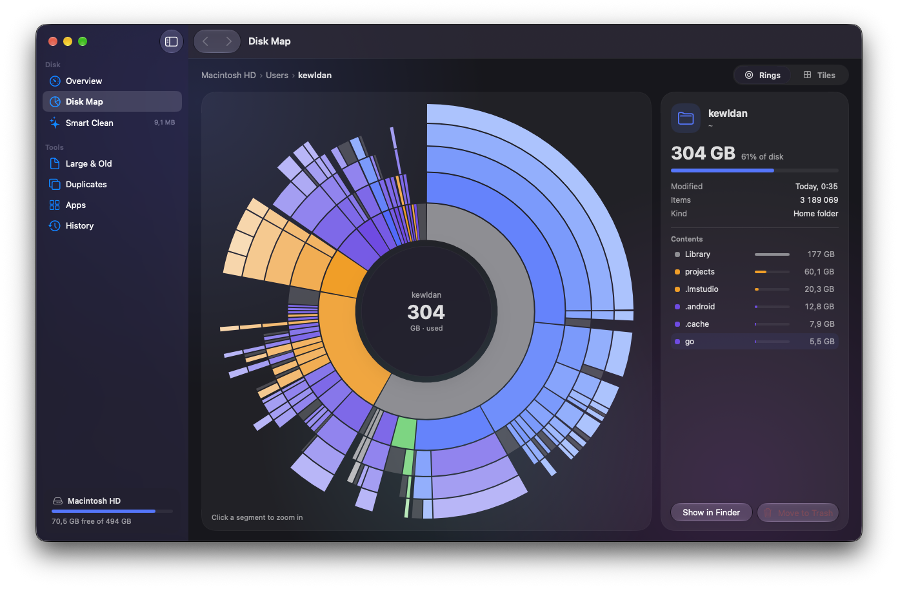 |
| **Tiles** | **Smart Clean** |
| 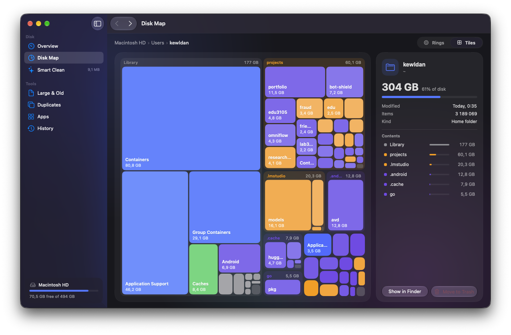 | 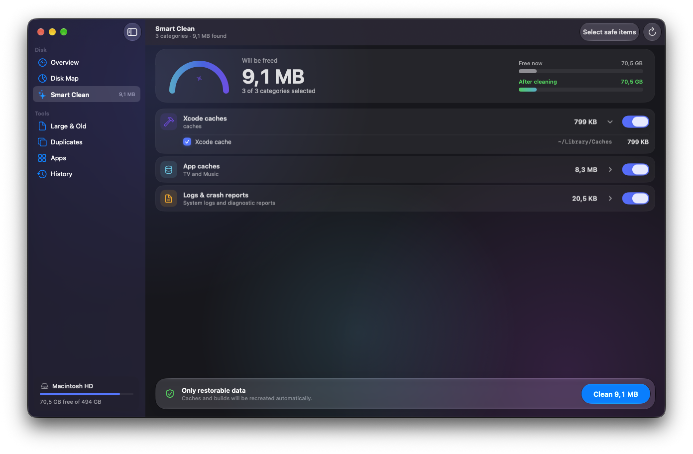 |
| **Duplicates** | **Apps** |
| 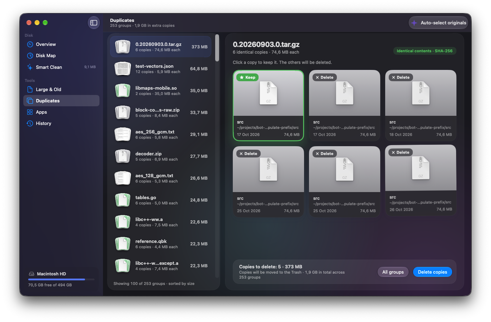 | 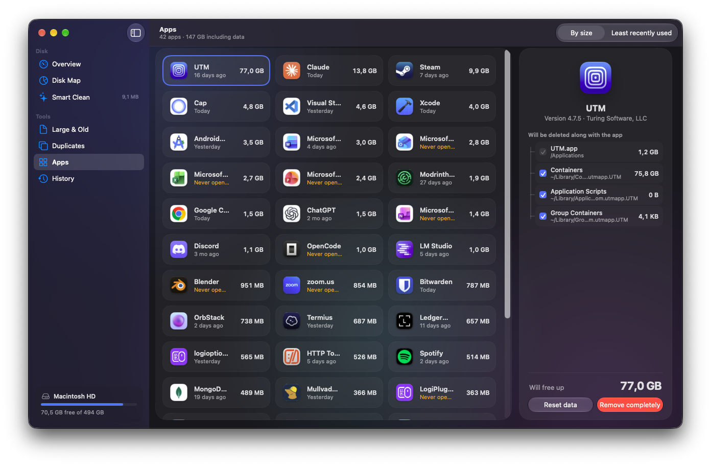 |
| **Large & Old** | **Welcome** |
| 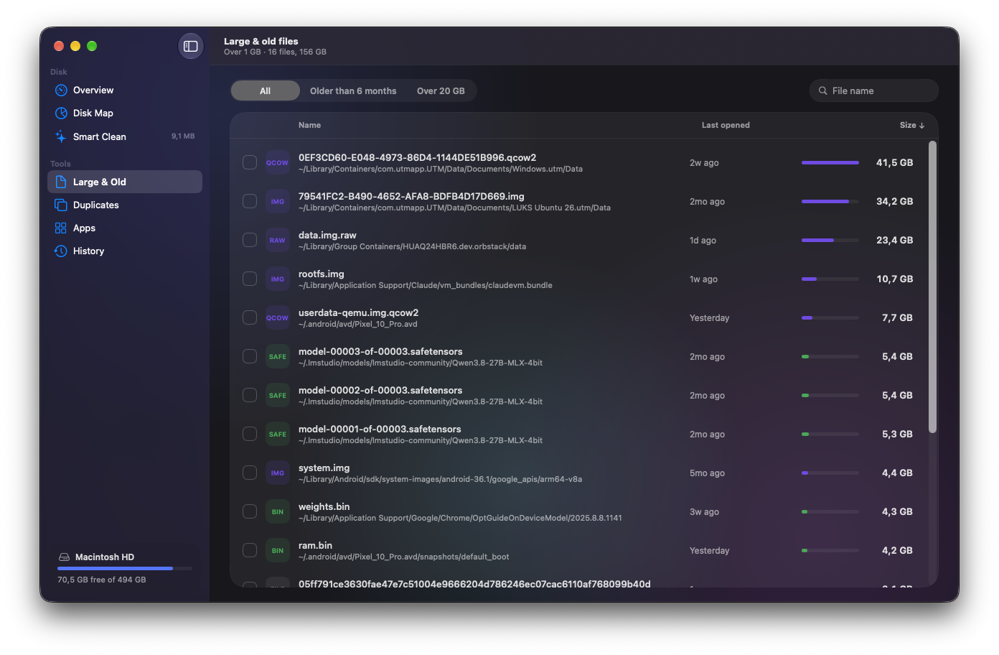 | 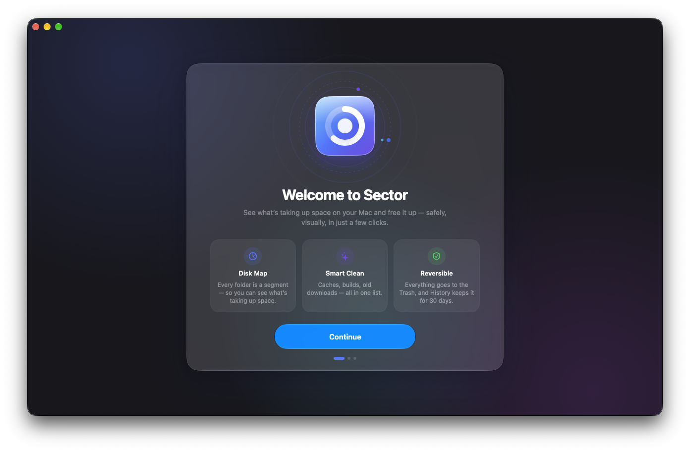 |

## ⚡️ Performance

Measured on an M4 Pro with a warm file system cache.

| Task | Result |
| --- | --- |
| Scan `~/projects` (2.06 M files and folders, 57 GB) | **6.5 s** — `du -sk` takes 30.7 s for the same folder |
| Scan a home folder (3.1 M files, 189 GB) | **47 s** |
| Memory for a 2 M-node tree | **~117 MB** (structure of arrays, ~35 bytes per node plus names) |
| Save / load the cached tree | **30 ms / 10 ms** |
| Hash 3.3 GB of duplicate candidates | **a few seconds** |

How it gets there:

- `getattrlistbulk(2)` returns the attributes of a whole directory in a few syscalls instead of one `stat` per file.
- Worker threads share a depth-first work stack and open directories with `openat` relative to their parent's descriptor.
- A directory's entries are committed to the tree in one batch, so children are contiguous and always come after their parent. Rolling sizes up is a single reverse pass.
- Hard links are counted once; mount points are skipped, so `/` counts the system and data volumes once and never wanders into external drives.

## 🧹 What Smart Clean finds

| Category | What's inside | How it's removed |
| --- | --- | --- |
| 🔨 Xcode caches | DerivedData, device support files, Xcode caches; archives marked for review | Deleted, rebuilt on demand |
| 📦 Stale `node_modules` | Projects untouched for 90+ days | Deleted, reinstalled on demand |
| 🐳 Docker | Dangling and unused images, orphaned volumes — via the `docker` CLI | `docker image rm` / `docker volume rm` |
| 📱 Simulators | Unavailable devices and old runtimes | `xcrun simctl delete` |
| 🗂️ App caches | `~/Library/Caches`, grouped by app; running apps are skipped | Deleted, recreated by the apps |
| 🗑️ Trash | Split into "older than 30 days" and the rest | Emptied |
| 📜 Logs | App logs and crash reports | Deleted |
| ⬇️ Old downloads | Installers, archives and other files older than 90 days, marked for review | Moved to the Trash |

> [!IMPORTANT]
> Sector never follows symlinks out of a cleanup target, never crosses mount points, refuses anything less than two levels inside your home folder, and never touches `Docker.raw`. Folders you add to **Settings → Exclusions** are never analyzed or suggested.

## 🛡️ Safety model

- 🗑️ **Trash first.** Large files, duplicates and apps go to the Trash unless you pick "Delete immediately" in the confirmation sheet.
- ↩️ **History.** Every cleanup is recorded. Anything still in the Trash can be restored to its original folder, and a toast offers **Undo** right after you delete.
- ✋ **You see it before it goes.** Large files, duplicates and apps go through a confirmation sheet that lists every item and the space it frees (an explicit setting turns it off). Smart Clean shows every category and item before you press **Clean**; its one-click **Clean** in the menu bar cleans the safe selection straight away.
- 🔒 **Local only.** Nothing leaves your Mac. There is no network code in the app.

## 🚀 Getting started

### Requirements

- macOS 26 or later (designed for macOS 27)
- Xcode 27 and [XcodeGen](https://github.com/yonaskolb/XcodeGen) (`brew install xcodegen`)

### Build and install

```sh
git clone <repo-url> sector && cd sector
scripts/install.sh        # release build → /Applications/Sector.app
```

Other scripts:

```sh
scripts/build-app.sh      # release build → build/Sector.app (pass "debug" for a debug build)
scripts/test.sh           # unit tests of the engine
scripts/check-strings.sh  # UI strings missing an English translation
```

### Signing

The Xcode project is generated from `project.yml`. To sign with your team — required for the widgets, and so Full Disk Access survives rebuilds — create `Config/Local.xcconfig`:

```
DEVELOPMENT_TEAM = ABCDE12345
```

Without it, builds are signed to run locally: the app works, but the widgets have no shared container to read from.

### Widgets

Right-click the desktop → **Edit Widgets** → search for **Sector**. There are two: **Free space** (small) and **Smart Clean** (medium). Clicking either opens Smart Clean.

## 🏗️ Architecture

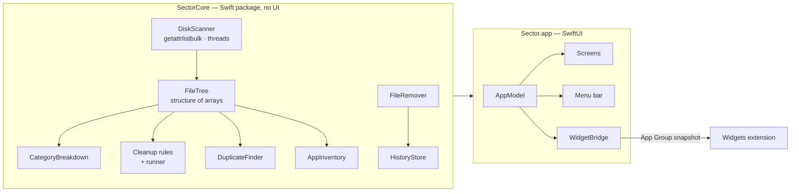

- **`SectorCore`** — the engine: scanner, tree, categories, cleanup rules, duplicate finder, app inventory, removal and history. No UI, covered by unit tests.
- **`Sector`** — the SwiftUI app. `AppModel` owns the scan, the tree and deletion; each screen lives in `Sources/Sector/Features/<Screen>`.
- **`Widgets`** — a WidgetKit extension that reads the snapshot the app writes into the App Group container.

<details>
<summary>🗂️ Project layout</summary>

```
Sources/
  SectorCore/         engine (Scanner, Categories, Cleanup, Duplicates, Apps, Removal, History, …)
  Sector/
    App/              scenes, AppModel, settings, routes
    Design/           tokens (colors, motion, metrics) and shared components
    Shell/            onboarding vs main window, sidebar, toasts, confirmation sheet
    Features/         one folder per screen, plus System/ (notifications, background scan, widgets bridge)
  sector-bench/       command-line scanner benchmark
Widgets/              WidgetKit extension
Tests/SectorCoreTests/
Resources/            Localizable.xcstrings, app icon, generated Info.plist
design/mockups/       the original HTML design, one file per screen
project.yml           XcodeGen spec for the app and the widgets
scripts/              build, install, test and localization checks
```

</details>

## 🌍 Localization

Sector speaks **English** and **Russian**. Russian is the source language; translations live in a String Catalog, `Resources/Localizable.xcstrings`, and `scripts/check-strings.sh` lists anything missing. To use the other language, pick it for Sector in System Settings → General → Language & Region → Applications.

## 🗺️ Known limitations

- 📈 The 30-day free-space chart fills in over time: Sector records one sample per day.
- 🐳 Docker cleanup needs the Docker or OrbStack daemon to be running; simulator cleanup needs Xcode.
- ⚙️ Without Full Disk Access, macOS asks separately for Desktop, Documents and Downloads, and some folders stay hidden.

## 📄 License

Sector is released under the [MIT License](LICENSE).
